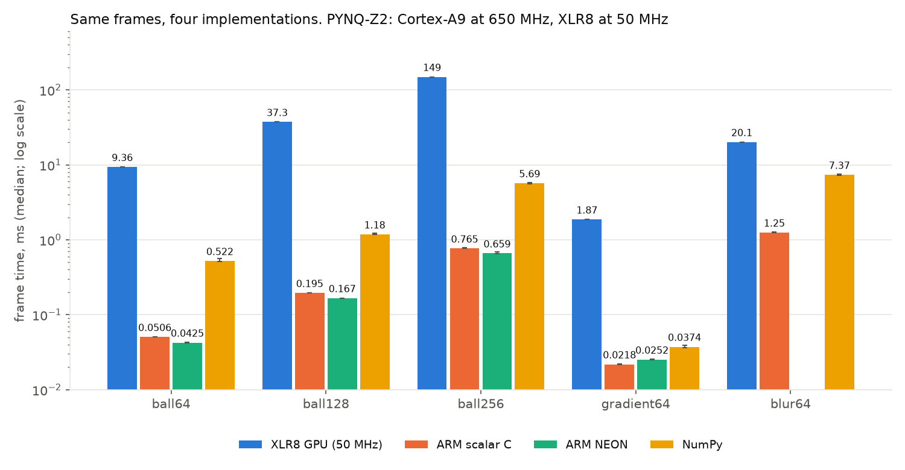
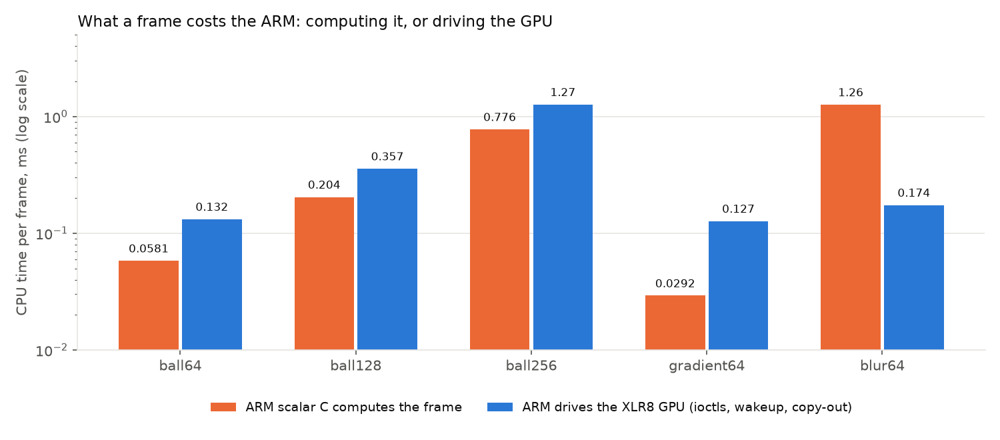

# Benchmarks: XLR8 GPU against the ARM cores (Phase 7)

Run 2026-11-07 on the PYNQ-Z2. Raw per-frame CSVs and `system.txt` are in `results/bench/`; the
tables below are generated from them by `tools/plot_bench.py` (full set in `bench_tables.md`).
Reproduce: `tools/board/demo.sh` (loads the driver), then `tools/board/run_bench.sh 1000`, then
`.venv/bin/python tools/plot_bench.py results/bench`.

## Setup

| | |
|---|---|
| ARM | Cortex-A9 (ARMv7, NEON), `armpll` 1.3 GHz, `cpu_6or4x` 650 MHz, no cpufreq driver (the clock is fixed, so there is no governor to pin) |
| GPU | XLR8 at 50 MHz (driver-set PL clock), 2 warps x 4 lanes, one bus transaction in flight |
| Software | kernel 5.15.19, gcc 11.2 `-O2 -mfpu=neon`, NumPy 1.21.5 |
| Method | 1,000 frames per run after 100 warmup frames (300 for the two largest GPU runs), every run pinned to core 1 with `taskset`; per-frame times from `CLOCK_MONOTONIC` |
| Correctness | before timing, each implementation's first 8 frames are compared exactly with the scalar reference; any difference aborts the run. All runs passed. |
| What a frame is | the finished image in ordinary cached application memory. For the GPU that includes copying out of the driver's non-cacheable buffer. |
| Scalar | `no-tree-vectorize` on the scalar functions. NEON uses intrinsics (`vmlaq`, `vcleq`, `vbslq`); the binary contains the NEON instructions. NEON blur was not written (skipped). |

## Frame time

| Workload | XLR8 GPU | ARM scalar | ARM NEON | NumPy |
|---|---|---|---|---|
| ball 64x64 | 9.36 ms | 0.051 ms | 0.043 ms | 0.52 ms |
| ball 128x128 | 37.3 ms | 0.195 ms | 0.167 ms | 1.18 ms |
| ball 256x256 | 149 ms | 0.765 ms | 0.659 ms | 5.69 ms |
| gradient 64x64 | 1.87 ms | 0.022 ms | 0.025 ms | 0.037 ms |
| blur 64x64 (3x3, two GPU passes) | 20.1 ms | 1.25 ms | n/a | 7.37 ms |

Medians; spreads are tight (5th to 95th percentile within a few percent, see `bench_tables.md`).

**The GPU loses on raw speed everywhere.** ARM scalar is 184x faster on ball64 (218x for NEON, 18x
for NumPy), 85x on gradient, and 16x on blur (NumPy beats the GPU on blur by 2.7x). This is the
expected result, not a surprise: a 650 MHz out-of-order core with NEON against a 50 MHz in-order
design that keeps one memory request in flight.

## Where the GPU's time goes

The GPU running is 99% of a frame. Everything else together (prepare 1.3 us, submit ioctl 9 to 18 us,
interrupt wakeup about 30 to 60 us, copy-out 76 us for 64x64) is under 2%.

| | ball64 | blur64 |
|---|---|---|
| CYCLES per frame | 462,134 | 998,822 |
| Bus transactions | 24,576 (6 per pixel) | 40,960 |
| Stall cycles per transaction | 15.1 | 15.4 |
| Cycles per transaction (all in) | 18.8 | 24.4 |

Time scales linearly with pixels (9.36 -> 37.3 -> 149 ms for 4x pixels each step). Each pixel costs
about 113 GPU cycles of which roughly 90 are waiting on DDR (6 serialized transactions at about 15
extra cycles each), so memory latency, not arithmetic, is the bottleneck. The gradient needs 1
transaction per pixel and runs 5x faster per pixel than the ball (6 per pixel), which fits.

Blur is slower on the GPU than its transaction count suggests because the FPGA build uses the
32-cycle sequential divider (needed to meet timing, see Phase 3) and the kernel divides 3 times per
pixel. Replacing the divide by 9 with a multiply is a Phase 8 candidate.

## CPU cost

| Workload | ARM computes it | ARM drives the GPU |
|---|---|---|
| ball64 | 0.058 ms | 0.132 ms |
| ball128 | 0.204 ms | 0.357 ms |
| ball256 | 0.776 ms | 1.27 ms |
| gradient64 | 0.029 ms | 0.127 ms |
| blur64 | 1.26 ms | 0.174 ms |

While the GPU runs, the CPU is almost idle (1% of a core: it sleeps until the interrupt), so the
CPU is free for other work during those 9 to 150 ms. But driving the GPU is not free: ioctls, the
wakeup and the copy-out cost 0.13 ms per 64x64 frame, **more than computing the frame on the ARM**
for ball and gradient. Only blur, which costs the ARM 1.26 ms, comes out ahead: 7x less CPU time
per frame on the GPU. The copy-out is a real part of that cost (the buffer is non-cacheable); a
consumer that reads the result in place, or hands it to another device, would not pay it.

## What this says

- At these sizes the XLR8 GPU is not a speedup, and with one transaction in flight at 50 MHz it
  cannot be one on simple per-pixel kernels. Matching the ARM would need roughly 100x fewer cycles
  per pixel.
- It is a correct, offloaded, interrupt-driven accelerator: bit-exact against the references,
  1% CPU use while running, with a clean Linux interface. The honest pitch is the integration and
  the verification, plus a scaling path.
- The lever is clear and measured: transactions per pixel and latency per transaction. Phase 8
  should attack that, in this order: kernel arguments (6 -> 1 transaction per pixel for the
  ball), bursts/coalescing, then more requests in flight. Compute-heavy kernels (blur-like) are the
  ones where the gap is smallest (16x) and where offload pays in CPU time.

## Limits of this comparison

- ARM runs at 650 MHz and the PL at 50 MHz; a faster PL clock was not tried (critical path
  18.5 ns), and a 100 MHz run earlier (see `driver_tests.md`) was out of spec and not used.
- The scalar/NEON versions are straightforward loops, not hand-tuned beyond the intrinsics; the
  NEON gain over scalar is small (about 15%) because the ball is store-bound at these sizes.
- Energy was not measured (no power meter).
- Two cores are present; all runs are pinned to one. A second core was idle.
