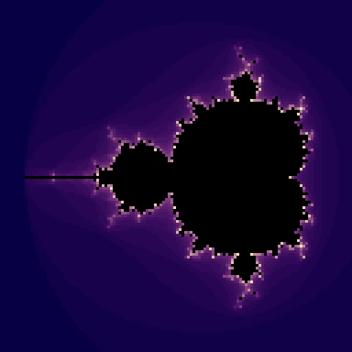
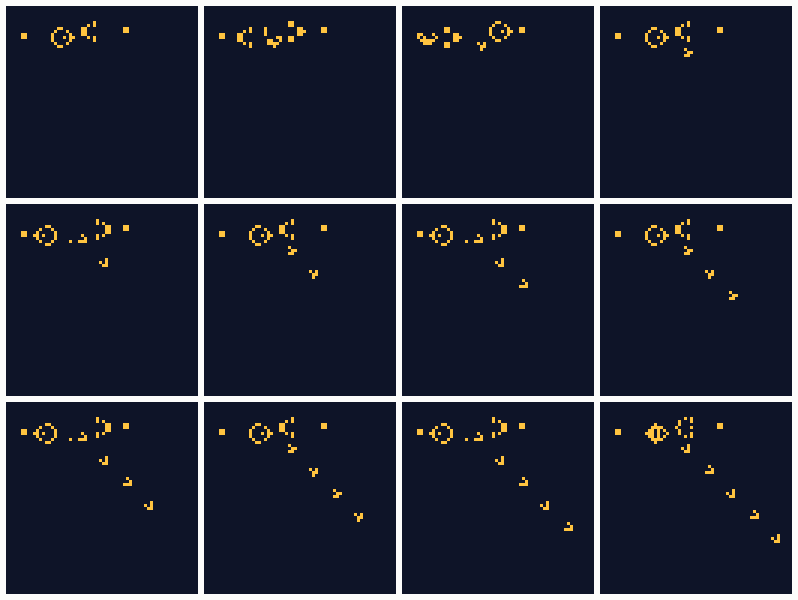

# Mandelbrot and Game of Life on the GPU

Run on the PYNQ-Z2 through `/dev/xlr8` (`tools/board/run_fractal_life.sh`), 50 MHz, hardware 0.2.0.
Kernels: `sw/kernels/mandelbrot128.asm` (656 instructions, generated by `tools/gen_mandelbrot.py`) and
`sw/kernels/life.asm` (61 instructions, `tools/gen_life.py`). References: `tools/mandel_ref.py`,
`tools/life_ref.py`. Tests: `tools/tests/test_mandelbrot.py`, `tools/tests/test_life.py` (ISA simulator
and Verilated RTL).

| | Result |
|---|---|
| Mandelbrot 128x128, two views | 16,384 of 16,384 pixels identical to the reference in both; 5,429,253 cycles = 108.6 ms per frame at 50 MHz, 16,384 bus transactions (one store per pixel) |
| Game of Life, 64x64 torus | 151 of 151 generations identical to the reference (glider gun, 150 generations); 753,000 cycles = 15.1 ms per generation, 65 generations/s |
| Fixed point vs floating point | the Q12 Mandelbrot agrees with a floating-point Mandelbrot on 4,093 of 4,096 pixels (inside or outside the set) |

## How the kernels work

- **Mandelbrot:** per pixel, 31 unrolled iterations of `z = z^2 + c` in Q12 fixed point. The GPU has no
  per-thread early exit, so a point that escapes is frozen at zero (multiplying by a sticky `alive`
  flag that the sign bit of `4.0 - |z|^2` clears), which also stops it overflowing. The colour comes
  from the iteration count, and points that never escape are black. The window (`x0`, `y0`, `step`) is
  passed as kernel arguments, so the ARM can pan and zoom between launches.
  The kernel needs a signed-free trick for the product `2*zr*zi`: it uses `(zr+zi)^2 - zr^2 - zi^2`,
  whose square is non-negative so the GPU's logical shift is enough.
- **Game of Life:** one thread per cell reads its 8 neighbours (coordinates wrap with AND masks, so the
  grid is a torus), counts them, and computes "sum == 3, or alive and sum == 2" with the sign-bit
  equality trick. One launch is one generation; the host swaps the source and destination buffers
  between launches, so there is no copy.
