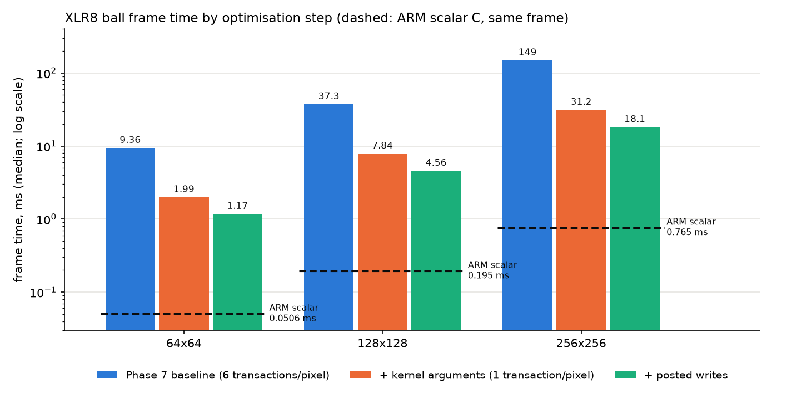

# Optimization results (Phase 8)

Measured on the PYNQ-Z2, 50 MHz PL clock, 1,000 frames per point (300 for the 128 and 256
sizes), median frame time including the copy-out to cached memory, every output verified exactly
against the CPU reference before timing. Raw CSVs: `results/bench/` (baseline),
`results/bench_step1_args/`, `results/bench_step2_posted/`. Each step was a separate FPGA build
that met timing (WNS and WHS non-negative, see the bottom).

## Ball frame, 64x64

| Step | Frame time | CYCLES | Bus transactions | vs baseline |
|---|---|---|---|---|
| Phase 7 baseline (parameters loaded from memory) | 9.365 ms | 462,134 | 24,576 | 1.0x |
| 1. Kernel arguments in registers | 1.992 ms | 93,697 | 4,096 | 4.7x |
| 2. Posted writes | **1.171 ms** | **52,741** | 4,096 | **8.0x** |
| (ARM scalar C, same frame) | 0.0506 ms | | | 185x faster than baseline, 23x faster than step 2 |

| Ball size | baseline | + arguments | + posted writes | total |
|---|---|---|---|---|
| 64x64 | 9.365 ms | 1.992 ms | 1.171 ms | 8.0x |
| 128x128 | 37.34 ms | 7.841 ms | 4.562 ms | 8.2x |
| 256x256 | 149.2 ms | 31.21 ms | 18.11 ms | 8.2x |

## What each step did

**1. Kernel arguments.** Hypothesis: the ball kernel does 5 loads per pixel for values that never
change, and each transaction costs about 19 cycles, so moving them into registers cuts the cost to
the store alone. Change: the hardware preloads `ARG0..ARG5` into `r8..r13` of every lane at the start
of each wave (`regfile` parameter `NARGS`, default 0 so the RAPTOR design is unchanged), the
register block gains six `ARGk` registers (hardware 0.2.0), `SUBMIT` carries the arguments
(uapi version 2), and `ball_args.asm` is 19 instructions with one transaction per pixel.
Result: transactions 24,576 -> 4,096 (exactly one per pixel), 4.7x faster on hardware. The
simulation predicted only 2.9x against an ideal memory; real DDR makes each removed transaction
worth more (15 stall cycles per transaction on hardware, 4 in simulation).

**2. Posted writes.** Hypothesis: after step 1 the only transaction is a store, and the GPU waits
for its write response (the slowest part of a DDR write) before continuing. Change: the bridge
completes a store when the AXI address and data are accepted and keeps up to 8 writes
outstanding. Three rules keep it correct, each with its own test:
a read waits for all earlier writes (read-after-write), `DONE` and the interrupt wait for all write
responses (so an interrupt-driven driver sees complete data), and a late write error is reported
with its own address before `DONE`. Result: 93,697 -> 52,741 cycles on hardware, 1.8x. That is
almost exactly the simulation's 52,739 cycles, which says the DDR write latency is now hidden.

## What did not move much, and why

- **Blur (9 loads + 1 store per pixel):** 20.14 ms -> 19.36 ms with posted writes (-4%) -> 18.81 ms
  with a divide-free kernel (multiply by 7282 and shift replaces `DIV` by 9, and by the row width;
  exact, no `DIV` left, 338 instructions instead of 316). Total -6.6%. The nine serialized loads
  per pixel dominate (40,960 transactions at about 23 cycles each); neither change touches them.
  The parameter-block ball kernel moved only 9% for the same reason (its five loads remain).
- **Not attempted, with the reasons:**
  - *Bursts / coalescing and more requests in flight for reads* would help blur and any
    load-heavy kernel; they change the GPU's bus protocol and `mem_unit` and are the next lever for
    reads.
  - *More lanes:* the register file already takes most of the 62% LUT use (it cannot map to RAM
    with async reset), so doubling the lanes does not fit without reworking it.
  - *Higher clock:* the reported critical path is 18.5 ns (the multiplier path), so 50 MHz is near
    the limit of this design as it stands.
  - *ISA additions (select/min/max):* not needed by any kernel measured here.

## Where the ball frame stands now

52,741 cycles for 4,096 pixels is 12.9 cycles per pixel with 4 bus cycles of that for the store.
The remaining time is the GPU issuing its 19 instructions (two cycles per instruction per warp,
one warp issuing at a time), so the next lever for this kernel is the instruction pipeline, not
memory. The ARM is still about 23x faster on this frame.

## Timing of the builds

| Build | WNS | WHS | LUTs |
|---|---|---|---|
| Baseline (`50mhz_linux`) | +0.644 ns | +0.092 ns | 30,996 |
| + kernel arguments (`50mhz_args`) | +0.427 ns | +0.084 ns | 32,820 |
| + posted writes (`50mhz_posted`) | +0.579 ns | +0.051 ns | 32,905 |
